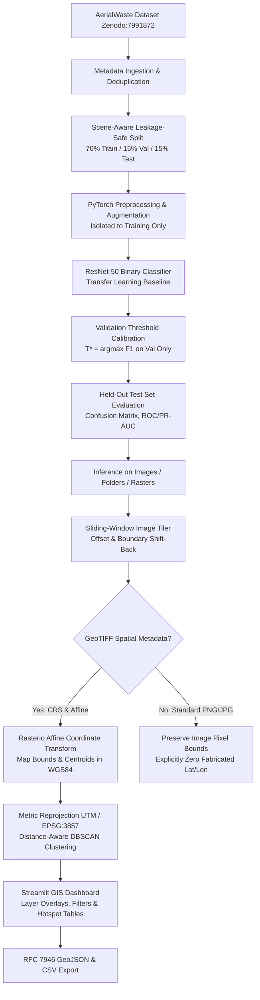

# Urban Waste Hotspot Detection & Spatial Risk Prioritization

> **Reproducible End-to-End AI Pipeline for Satellite and Aerial Imagery-Based Urban Waste Detection, Coordinate Mapping, Hotspot Clustering, and Interactive GIS Dashboard.**

[](#test-suite)
[](https://www.python.org/)
[](https://pytorch.org/)
[](data/raw/LICENSE)

---

## 📌 1. Project Overview

This repository provides an operational research prototype designed to assist municipal environmental monitoring agencies in detecting candidate illegal waste dumps, unpermitted landfills, and urban accumulation hotspots using high-resolution aerial and satellite imagery.

### System Architecture Workflow



---

## 🚀 2. Quickstart & Installation

### Prerequisites
- Python 3.10 or higher
- GDAL / PROJ (standard with Rasterio wheel)
- (Optional) CUDA-compatible GPU

### Install Dependencies
```bash
# Clone and enter directory
cd urban-waste-hotspot-detection

# Install required packages
pip install -r requirements.txt
```

---

## 📦 3. Dataset Sourcing & Preparation

The pipeline uses the **AerialWaste** benchmark dataset hosted on Zenodo:
- **Zenodo Record**: [records/7991872](https://zenodo.org/records/7991872)
- **License**: Creative Commons Attribution 4.0 International (CC-BY-4.0)
- **Target**: Binary classification of waste-affected areas vs. natural/urban background.

### Ingestion & Scene-Aware Splitting
To download metadata and partition data into leakage-safe splits without spatial or sensor boundary leakage:

```bash
# Ingest metadata and create disjoint scene splits
python -m waste_hotspot.data --config configs/default.yaml
```

Generated partitions are saved directly to `data/processed/splits/`:
- `train.csv` (70% - strictly for model training)
- `val.csv` (15% - for early stopping and threshold calibration $T^*$)
- `test.csv` (15% - held-out strictly for unbiased final evaluation)

---

## 🧠 4. Model Training & Validation

The baseline classifier is built upon **ResNet-50** with an adaptive transfer learning head:
- Pretrained on ImageNet-1K with ImageNet normalization constants ($\mu = [0.485, 0.456, 0.406]$, $\sigma = [0.229, 0.224, 0.225]$).
- Cross-Entropy Loss with inverse class-frequency weighting to address class imbalance.
- `ReduceLROnPlateau` learning rate scheduling and early stopping based on validation loss.
- Atomic checkpointing (`artifacts/best_model.pth` and `artifacts/training_history.json`).

### Run Training

```bash
# Full training run
python -m waste_hotspot.train --config configs/default.yaml --epochs 25 --batch-size 32

# Rapid dry-run check (runs 2 batches per epoch)
python -m waste_hotspot.train --config configs/default.yaml --dry-run
```

---

## 📈 5. Evaluation & Decision Threshold Calibration

Evaluation follows strict methodological boundaries:
1. **Decision Threshold Calibration**: Optimal decision threshold $T^*$ is calibrated strictly on **validation data** (maximizing positive-class F1 score). Test data is never used for threshold selection.
2. **Comprehensive Metrics**: Reports precision, recall, positive/macro/weighted F1-scores, $2 \times 2$ confusion matrices, ROC-AUC, PR-AUC, and support counts.

```bash
# Evaluate checkpoint on held-out test set
python -m waste_hotspot.evaluate --config configs/default.yaml --tune-threshold --output outputs/evaluation_report.json
```

Evaluation report is serialized to `outputs/evaluation_report.json`.

---

## 🔍 6. Inference, Tiling & Geospatial Processing

### A. Folder & Single Image Inference
Run inference across an individual image or a directory of aerial photos:

```bash
# Inference on single image
python -m waste_hotspot.inference --input data/raw/images/1.png --output outputs/prediction_single.csv

# Batch inference on a directory
python -m waste_hotspot.inference --input data/sample_images --output outputs/predictions.csv --threshold 0.50
```

### B. High-Resolution Sliding-Window Tiling
For large aerial passes or full satellite scenes:
- Configurable window dimensions (e.g. 256x256 px) and overlap/stride (e.g. 200 px).
- Edge shift-back guarantees 100% surface coverage without boundary truncation.
- Bounding box offsets `(x_min, y_min, x_max, y_max)` and source image IDs are preserved.

```bash
# Run tiled inference directly on a large image
python -m waste_hotspot.inference --input imagery/large_scene.tif --tile --tile-size 256 --stride 200 --output outputs/tiled_predictions.csv
```

### C. Geospatial Affine Coordinate Transformation
Converts pixel tile coordinates to geographic coordinates using Rasterio:
- For GeoTIFFs: maps bounding boxes and centroids to valid coordinates (WGS84 / EPSG:4326).
- For standard images (PNG/JPG): sets `has_georeference = False`, strictly preserving pixel offsets without manufacturing fake latitude/longitude.

```bash
# Inspect georeferencing and bounding coordinates
python -m waste_hotspot.geospatial --raster imagery/large_scene.tif --bbox 0 0 256 256
```

### D. Metric DBSCAN Hotspot Clustering
Groups candidate detections into geographical clusters:
- Reprojects detections into metric projected coordinate systems (local UTM or EPSG:3857) to ensure clustering radii are measured in **meters**, not degrees.
- Computes spatial centroids, member counts, mean/max confidence scores, and convex hull boundary polygons.

```bash
# Cluster candidate detections from predictions CSV into GeoJSON hotspots
python -m waste_hotspot.clustering --input outputs/predictions.csv --output outputs/hotspots.geojson --eps 250 --min-samples 3
```

---

## 🖥️ 7. Interactive Streamlit GIS Dashboard

The dashboard provides an intuitive, interactive interface for environmental inspectors:
- **Detection & Analysis**: Upload aerial photos or select sample scenes, run inference, and preview images with detection highlights.
- **Geospatial Map & Hotspots**: Interactive Folium map displaying individual detections and DBSCAN hotspot cluster polygons with popups.
- **Dynamic Filtering**: Real-time confidence cutoff ($T^*$) and cluster neighborhood ($eps$) sliders.
- **Export**: One-click download of standardized predictions CSV (16–20 columns) and RFC 7946 compliant GeoJSON.

### Launch Dashboard
```bash
streamlit run app/dashboard.py
```
Open [http://localhost:8501](http://localhost:8501) in your browser.

---

## 🧪 8. Test Suite

The repository includes a comprehensive, multi-tiered automated test suite with **297 unit, integration, stress, adversarial, and real-world workload tests**:

```bash
# Run all tests
python -m pytest tests -v

# Run E2E test suite
python -m pytest tests/e2e -v

# Run module-specific unit tests
python -m pytest tests/test_tiling.py tests/test_geospatial.py tests/test_clustering.py
```

### Test Coverage Highlights:
- **Tier 1 (Feature Coverage)**: Data loading, deduplication, train/eval transform isolation, simplex constraints, tiling sliding windows, geospatial transform, DBSCAN metric clustering, and dashboard schemas.
- **Tier 2 (Boundary & Corner Cases)**: Corrupt files, 1x1 single-pixel images, zero-detection frames, collinear points, identical coordinates, missing CRS fallback, extreme thresholds (0.0 and 1.0).
- **Tier 3 (Pairwise Combinations)**: Tiling + Geospatial projection, Inference + Clustering + GeoJSON export, non-georeferenced fallback workflows.
- **Tier 4 (Real-World Workloads)**: End-to-end 2048x2048 satellite scene pipeline, multi-resolution drone survey pipeline, and full train-calibrate-evaluate lifecycle.

---

## ⚖️ 9. Responsible Interpretation & Guidelines

1. **Screening Signals Only**: Model predictions are statistical screening indicators to prioritize inspection routes, **not** verified ground-truth labels.
2. **False Positive Factors**: Shadows, dense vegetation, agricultural plastic mulch, dry soil, and construction aggregate can produce visual patterns similar to waste accumulation.
3. **No Legal Attribution**: Detections must never be used to identify property owners or make accusations of illegal dumping without field verification.
4. **Human Review Requirement**: All high-priority hotspots must undergo manual confirmation by trained aerial imagery analysts or on-site inspectors.

---

## 📁 10. Repository Layout

```text
urban-waste-hotspot-detection/
├── README.md                          # Master documentation & user guide
├── requirements.txt                    # Project dependencies
├── pyproject.toml                      # Build and pytest configuration
├── .gitignore                          # Ignored caches, datasets, checkpoints
├── configs/
│   └── default.yaml                    # Global hyperparameters & paths
├── data/
│   ├── raw/                            # AerialWaste raw metadata & imagery
│   │   ├── training.json
│   │   ├── testing.json
│   │   ├── LICENSE
│   │   └── images/
│   └── processed/                      # Deduplicated, leakage-safe CSV splits
│       └── splits/
│           ├── train.csv
│           ├── val.csv
│           └── test.csv
├── src/
│   └── waste_hotspot/
│       ├── __init__.py
│       ├── data.py                     # Dataset ingestion & scene partitioning
│       ├── preprocessing.py            # PyTorch transforms & Dataset classes
│       ├── model.py                    # ResNet-50 / EfficientNet classifiers
│       ├── train.py                    # Training pipeline with early stopping
│       ├── evaluate.py                 # Evaluation & validation threshold calibration
│       ├── inference.py                # Single & batch folder prediction CLI
│       ├── tiling.py                   # Sliding-window tiling & shift-back
│       ├── geospatial.py               # Rasterio affine conversion & GeoJSON export
│       └── clustering.py               # Metric projected CRS DBSCAN clustering
├── app/
│   └── dashboard.py                    # Interactive Streamlit GIS application
├── tests/
│   ├── e2e/                            # Tier 1-4 comprehensive integration test suite
│   ├── test_data.py
│   ├── test_preprocessing.py
│   ├── test_model.py
│   ├── test_train.py
│   ├── test_evaluate.py
│   ├── test_inference.py
│   ├── test_tiling.py
│   ├── test_geospatial.py
│   └── test_clustering.py
├── artifacts/                          # Trained checkpoints (.pth) & training logs
└── outputs/                            # Generated predictions CSV & GeoJSON layers
```

---

## 📜 11. Citation & Licensing

- **AerialWaste Dataset**: [Zenodo: records/7991872](https://zenodo.org/records/7991872) (CC-BY-4.0).
- **Codebase License**: MIT License. See [LICENSE](LICENSE) for details.
